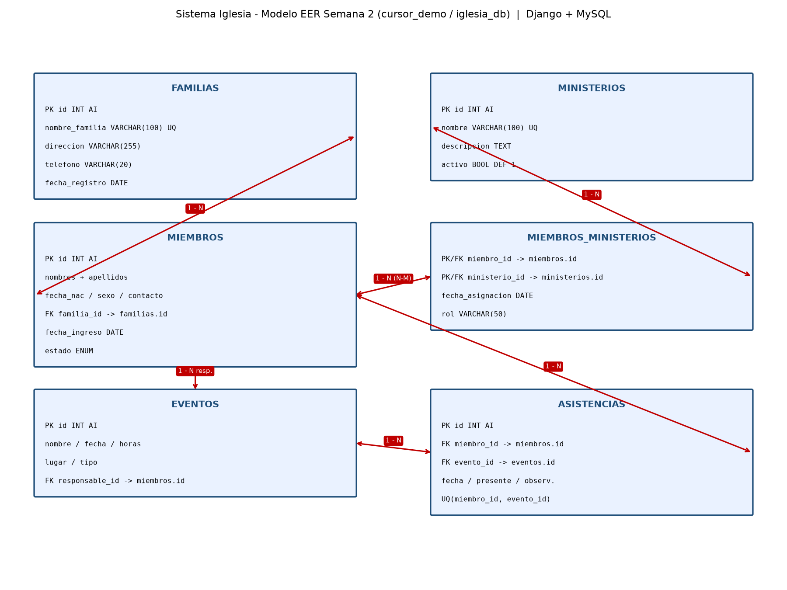

# Sistema de Gestión para Iglesia

Aplicación web para administrar **miembros, inventario, eventos/asistencia y reportes** de una institución religiosa. Desarrollada con Django y MySQL como proyecto de Servicio Social.



## Funcionalidades

- **Miembros**: alta, edición, consulta, baja lógica, familias y ministerios (relación N-M).
- **Inventario**: equipos, disponibilidad calculada, préstamos y devoluciones con validación de existencias y fechas.
- **Eventos y asistencia**: eventos, registro con estados (presente/ausente/justificado/retraso) y consulta por miembro.
- **Reportes**: asistencia por evento, crecimiento mensual, inventario y demografía; exportación a **PDF** y **Excel**.
- **Panel**: indicadores en vivo (miembros activos, eventos, asistencias, equipos, préstamos atrasados).
- **Acceso**: login obligatorio, 4 roles y control de escritura/eliminación por rol.
- **Salud**: endpoint `/salud/` para monitoreo.

## Stack

- Python 3.14 · Django 5.2 LTS
- MySQL 8.0 (PyMySQL)
- WhiteNoise (estáticos) · Gunicorn (producción)
- ReportLab (PDF) · openpyxl (Excel)

## Estructura

```
sistema_iglesia/
  config/        # settings, urls, middlewares y permisos
  miembros/      # CRUD de miembros, familias y ministerios
  inventario/    # equipos, préstamos y devoluciones
  eventos/       # eventos y asistencias
  reportes/      # consultas y exportación PDF/Excel
  templates/     # plantillas compartidas
  tests/         # integración, formularios, errores y rendimiento
docs/            # reglas de negocio y diccionario de datos
modelo_iglesia.sql
```

## Puesta en marcha (local)

1. Clonar e instalar dependencias:

```powershell
git clone https://github.com/ektorlast23/sistema-iglesia.git
cd sistema-iglesia
python -m venv venv
venv\Scripts\activate
pip install -r sistema_iglesia\requirements.txt
```

2. Configurar MySQL y variables de entorno:

```powershell
$env:MYSQL_DB="cursor_demo"
$env:MYSQL_USER="tu_usuario"
$env:MYSQL_PASS="tu_clave"
$env:MYSQL_HOST="127.0.0.1"
$env:MYSQL_PORT="3306"
```

Para producción, copia `sistema_iglesia\.env.example` y define `DJANGO_SECRET_KEY`, `DJANGO_DEBUG=0`, `DJANGO_ALLOWED_HOSTS` y `DJANGO_CSRF_TRUSTED_ORIGINS`.

3. Migrar, crear roles y usuario administrador:

```powershell
cd sistema_iglesia
python manage.py migrate
python manage.py crear_roles
python manage.py createsuperuser
```

> Si partes del esquema existente (`modelo_iglesia.sql`), usa `python manage.py migrate --fake-initial` para no recrear las tablas.

4. (Opcional) Datos de demostración:

```powershell
python manage.py cargar_demo
```

5. Ejecutar:

```powershell
python manage.py runserver
```

Abrir http://127.0.0.1:8000/ (login) o http://127.0.0.1:8000/admin/.

## Pruebas

```powershell
cd sistema_iglesia
python manage.py test
```

La suite usa SQLite en memoria para no requerir permisos de creación en MySQL. Estado actual: **239 pruebas OK**.

## Roles

| Rol | Escribe en | Elimina |
|---|---|---|
| Administrador | todos los módulos | sí |
| Secretaría | miembros y eventos | no |
| Encargado de inventario | inventario | no |
| Consulta | solo lectura | no |

## Estado del proyecto

- **Semanas 1–10 completadas**: análisis, modelo de datos, UI/UX, estructura base, CRUD de miembros, inventario, eventos/asistencia, reportes, pruebas y optimización.
- **Pendiente**: validación de usabilidad con usuarios reales, base de datos de producción, despliegue y respaldos.

## Autor

**ektorlast23** — Proyecto de Servicio Social, Técnico en Desarrollo de Software en Código Abierto.
